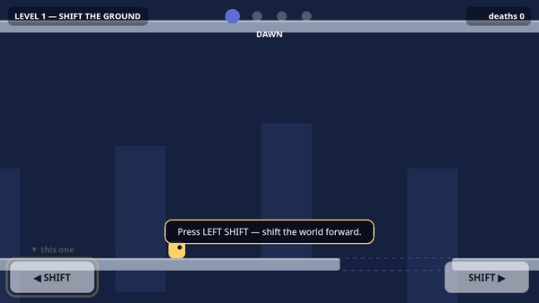

# Only SHIFT

A tiny auto-runner with exactly two buttons: **Left Shift** and **Right Shift**.

You don't walk. You don't jump. The little square runs on its own — your only job
is to shift the world between four states (**DAWN → DUSK → NIGHT → VOID → DAWN…**)
so the road exists, the spikes don't, and gravity points the way you need.

Each state changes exactly one thing: which platform set is real (A or B), or
which way gravity pulls. Two shifts = same platforms, flipped gravity.
Dashed platforms are real in another state. Spikes only exist in one state each.
And in the **Ratchet** zones, the ring only moves forward — no backshift,
so plan your loop before you enter.

**7 levels, about 5 minutes.** Instant respawn, no punishment for dying.

## Play

Open `index.html` in any modern browser. No build step, no dependencies —
the whole game is one self-contained HTML file.

- **Left Shift** — shift the world forward
- **Right Shift** — shift the world back (locked inside Ratchet zones)
- **R** — restart level
- **M** — music on/off
- Touch/mouse: the on-screen SHIFT pads work too

## About

Made for **GitHub Game Off 2026** (theme: SHIFT) as a time-boxed solo
experiment (12–16 hours total budget). Design goal: find out how much game
fits into a single key — then add exactly one twist (the state ring) and
one memorable constraint (the Ratchet).

## AI disclosure

This game was designed and built with the help of AI tools: an AI assistant
wrote and tested much of the code under the author's direction, and the
author play-tested, tuned the levels, and made all design decisions.
All art is drawn with code (Canvas primitives); all music and sound effects
are synthesized live with WebAudio. No pre-made assets were used.

## License

MIT — see `LICENSE`.
